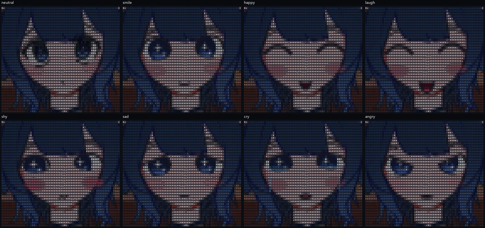
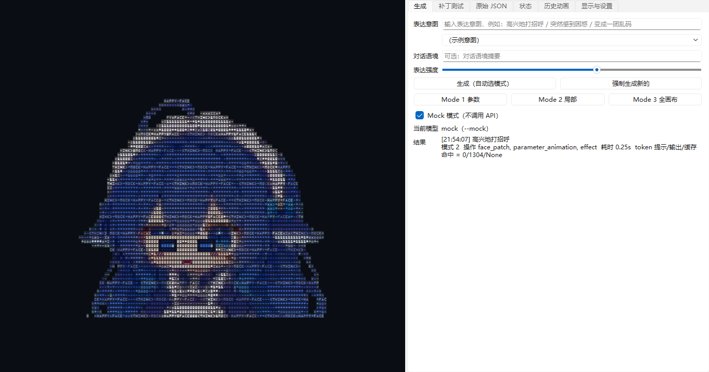
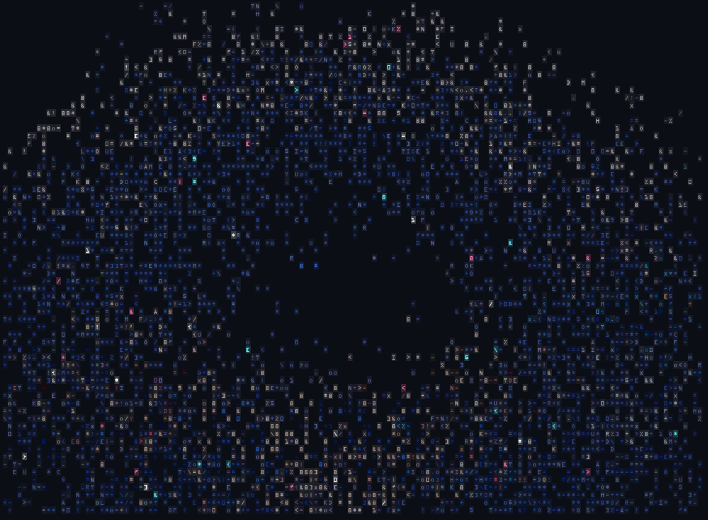
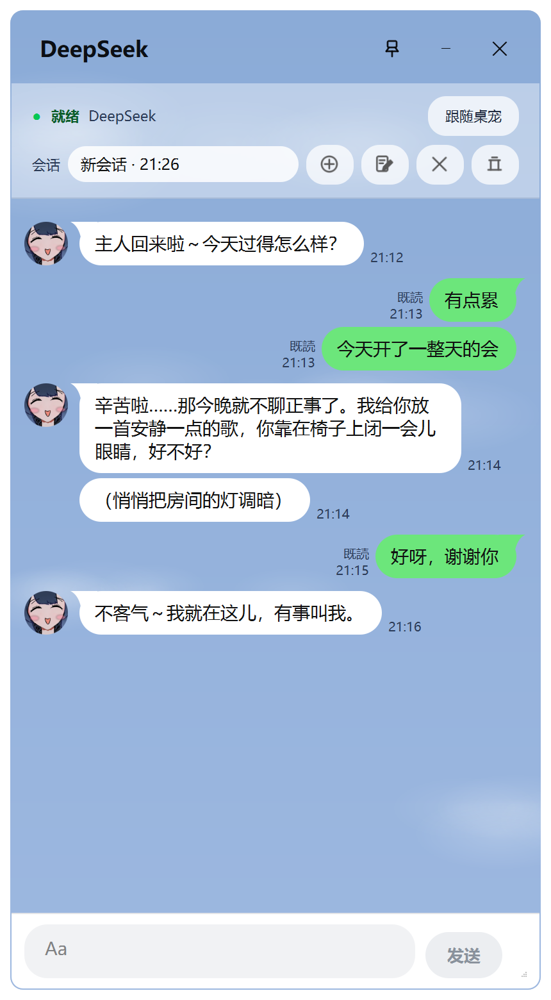

# dsapi-pet-ascii：给「桌面大肥鱼」加上字符画脸、永久记忆和她自己的小房间

> 名字里的 **dsapi** 指 DeepSeek API：两个扩展都由 DeepSeek API 驱动。本项目基于桌宠 dsh-pet（桌面大肥鱼）开发，但**没有**做与 DeepSeek Harness（`dsh`，DeepSeek 的智能体工具）的联动。程序内部的一些名字仍沿用旧名 dsh-pet-ascii（例如 Windows 凭据 `dsh-pet-ascii-spotify`）。

这是给开源桌宠 [MerZlin/dsh-pet-indesktop](https://github.com/MerZlin/dsh-pet-indesktop)（桌面大肥鱼，**WebM Chat 版**）做的两个**非官方**扩展。原作者已同意以非商业方式分享本项目，详见 [THIRD_PARTY_NOTICES.md](THIRD_PARTY_NOTICES.md)。

- **pet_memory**（`pet_memory/`）：四层永久聊天记忆，外加回复提速。
- **pet_ascii**（`ascii_pet/`）：由 DeepSeek 驱动的彩色字符画形象。她会自己设计表情、会睡觉、有自己的小房间，还可以用你的 Spotify 放歌。

两个扩展都运行在桌宠自带的 Python 里，不需要另外装运行环境。安装器只改你电脑上已经装好的那份桌宠，本仓库不包含、也不分发上游程序。

**装好以后怎么用**（窗口、菜单、聊天、房间、常见问题）：见 [使用说明.md](使用说明.md)。


---

## 它能做什么

**永久记忆与提速（pet_memory）**

| 层 | 内容 |
|---|---|
| L1 工作记忆 | 本会话最近的原文 |
| L2 情节记忆 | 后台把对话整理成摘要（事件、关系、约定、待办），最近几段作为“前情提要” |
| L3 语义记忆 | 后台抽取的长期事实（称呼、偏好、经历、约定），按 key 去重更新 |
| L4 原始历史 | 每条消息永久入库（SQLite + 全文索引），清空会话也不会丢；问“还记得…/上次…”时检索原话 |

- 聊天时不额外调用模型：检索是本地全文索引，整理在后台进行。
- 提速：关闭 DeepSeek 默认的“思考模式”（桌宠本来也会把思维链丢掉）、复用长连接、真正逐字流式输出，并按前缀缓存优化请求结构。
- 你可以在 `memory\notes.md` 里手写永久设定（称呼、世界观、禁忌话题……），每次聊天都会带上。

**字符画形象（pet_ascii）**

- **画面**：一幅女仆插画整体转成高密度彩色字符画；五官由类似 Live2D 的面部骨架驱动，用手绘表情差分连续变形，画风始终是原画的。
- **与聊天联动**：主模型在每次回复开头顺带写一个表情标签。标签在显示前被剥掉，本地立即演出，不额外请求 API；说话时嘴会动。
- **自创表情与表情进化**：现有表情不贴切时，她可以当场设计新表情；后台会定期回顾对话和你的 👍/👎，新建、修改、合并或淘汰表情，每一版都可以回滚。
- **自主创作**：没人理她时，她会用绘图图元发明新的五官部件、改造面部骨架，或做整屏的字符演出。每个候选都在本地真实渲染并检查，由她决定采用还是放弃。
- **睡眠**：30 分钟没有互动她会睡着。呼吸、梦话、鼻涕泡全部本地编排，不花 API；给她发消息会把她吵醒（6 种反应）。
- **虚拟房间**：她有一个只属于自己的文件夹，可以在里面写日记、画字符画、整理东西、给你留便条，也可以什么都不做。你通过一扇“单向玻璃”（独立的房间窗口）观察，还可以送礼物进去。房间的事和聊天的事互相记得。
- **看图**：DeepSeek 主模型看不了图片，所以房间里的图片会转成字符画、颜色地图和 Windows 自带的文字识别结果给她看；能看图的副模型 `deepseek-flash` 也会替她描述一遍。
- **副人格（影子模式）**：她睡着时回顾最近的相处，提议“慢慢形成的小习惯”。每条提议都要经过证据逐字核对、规则审查和独立审核。默认只在测试台里给你看，不进提示词。
- **Spotify（可选）**：给她一个放歌的权限，放不放、放哪首由她决定。你正在听歌时只排队、不打断，并有每小时 / 每天的次数上限。
- 原来那只会跑来跑去的桌宠默认藏起来，它的右键菜单、AI 对话窗口、灵动岛都整合进字符画窗口。右键菜单里字符画用不到的原桌宠功能默认去掉，「大小」改成调字符画窗口。
- **对话窗口三种风格**：字符画风格（默认）、仿 LINE 的聊天界面（蓝天背景、白 / 绿圆角气泡、她的笑脸头像、每条消息的时间和「既読」、“Aa” 输入框），或保持桌宠原样。在字符画窗口上右键 → 字符画 →「对话框风格（AI 对话窗口）」随时切换。

| 表情一览 | 开发测试台 | 全画布演出 |
|---|---|---|
|  |  |  |

> 测试台和全画布演出截图里是旧角色“深深”（由上游素材转换），现在默认角色是女仆。



LINE 风格的对话窗口（截图里是虚构的对话）。

更详细的设计、配置项和每个版本的改动，见开发说明 [ascii_pet/README.md](ascii_pet/README.md) 和 [pet_memory/README.md](pet_memory/README.md)。当前版本：pet_ascii v1.4.2，pet_memory 1.0.0。

---

## 需要什么

| 项目 | 说明 |
|---|---|
| 系统 | Windows 10 / 11（作者只在 Windows 11 上测试过） |
| 上游桌宠 | [MerZlin/dsh-pet-indesktop](https://github.com/MerZlin/dsh-pet-indesktop/releases) 的 **WebM Chat 版**，安装包 `dsh-pet-standalone-webm-chat-setup.exe`，默认装在 `%LOCALAPPDATA%\Programs\dsh-pet-standalone-webm-chat`。**本扩展在上游 4.2.1 版上开发和测试**；不带 AI 对话的 “WebM” 版不能用 |
| DeepSeek API Key | 在桌宠**自己的**聊天设置里填好 DeepSeek 的 Key（扩展会沿用它，不需要另外填） |
| Python 3.8 以上 | **只有安装器需要**（任意版本，只用标准库），桌宠运行时不需要。可以从 [python.org](https://www.python.org/downloads/windows/) 安装 |
| Spotify（可选） | Spotify Premium，以及你自己在 Spotify 开发者后台建的一个应用（见下文） |
| 文字识别（可选） | 房间里看图片时识别文字，用的是 Windows 自带的 OCR，需要系统里装有**中文（简体）光学字符识别**语言组件 |
| 字体（可选） | 装有 `OCR A Extended` 字体时最接近设计的样子（Microsoft Office 自带）；没有时自动改用 Consolas |

---

## 安装

1. 安装上游桌宠（WebM Chat 版），启动一次，在它的设置里填好 DeepSeek API Key，确认能正常聊天。
2. 在托盘图标上右键 →「退出」，把桌宠完全关掉（多开的话每一只都要关）。
3. 下载本仓库（GitHub 页面上 Code → Download ZIP），解压到任意位置。
4. 双击 **`install.bat`**。安装器会先列出它找到的桌宠和打算做的事，按回车确认。它会：
   - 把 `dsh-pet-standalone-webm-chat.exe` 备份为 `dsh-pet-standalone-webm-chat.exe.orig`；
   - 改写 exe 里的启动脚本，让桌宠启动时先加载扩展（只改这一处，详见“工作原理”）；
   - 把 `pet_memory` 复制到 `安装目录\_internal\pet_memory`，把 `ascii_pet` 复制到 `安装目录\ascii_pet`。
5. 像平时一样启动桌宠。记忆和提速这时已经生效。
6. 打开字符画窗口：双击 `安装目录\ascii_pet\open_lab.bat` 打开开发测试台，在「显示与设置」页勾选 **「随桌宠启动字符画窗口，并与对话联动」**，然后重启桌宠。

之后字符画窗口会随桌宠出现，原来的桌宠默认隐藏。在字符画窗口上右键，就是原桌宠的完整菜单，最上面多了字符画自己的选项。

日常怎么用，见 [使用说明.md](使用说明.md)。

- 想看她的房间：双击 `安装目录\ascii_pet\open_room.bat`。想要桌面快捷方式，就自己建一个，目标填 `"…\dsh-pet-standalone-webm-chat.exe" --ascii-room`。
- 桌宠装在别的位置时，在命令行运行 `python install.py --dir "桌宠安装目录"`。
- `python install.py --status` 只查看当前状态，`--dry-run` 只检查、不写入。

### 升级本扩展

从旧版本升级：在托盘退出桌宠，下载新版本，再运行一次 `install.bat` 即可。安装器会换掉安装目录里的 `_internal\pet_memory` 和 `ascii_pet` 两个文件夹；你的记忆、设置、表情库和房间都在 `%APPDATA%`，不受影响。

### 桌宠更新以后

桌宠自动更新（或重装）会用新的 exe 覆盖掉改过的那个，扩展就不会再加载，桌宠照常以原版运行。**更新后请重新运行一次 `install.bat`**。你的记忆、设置和房间都在 `%APPDATA%`，不受更新和重装的影响。

上游新版本如果改了启动脚本，安装器会自动改用“通用包装”方式：先加载扩展，再原样运行新版自带的启动脚本。如果新版换了 Python 版本（现在是 3.11），安装器会拒绝安装，并说明原因。

### 卸载

1. 从托盘退出桌宠。
2. 双击 **`uninstall.bat`**。它会用 `.orig` 备份还原原版 exe，并删除 `_internal\pet_memory` 和 `ascii_pet` 两个文件夹。
3. 数据不会被删除，不需要的话可以自己删：
   - `%APPDATA%\dsh-pet-standalone-webm-chat\memory\`：永久记忆（`memory.db`、`notes.md`、`memory_config.json`、记忆快照）
   - `%APPDATA%\dsh-pet-standalone-webm-chat\ascii_pet\`：字符画设置、表情库、房间、动画缓存等
   - Windows 凭据管理器里名为 `dsh-pet-ascii-spotify` 的凭据（只有连过 Spotify 才有）

注意：桌宠本体的聊天会话和设置也在 `%APPDATA%\dsh-pet-standalone-webm-chat\` 下，请只删上面列出的两个文件夹。

---

## 配置

| 文件（都在 `%APPDATA%\dsh-pet-standalone-webm-chat\` 下） | 作用 |
|---|---|
| `ascii_pet\config.json` | 字符画的全部设置，首次运行自动生成，改完重启桌宠生效。大部分开关也能在测试台或右键菜单「字符画」里改。字段说明见 [ascii_pet/README.md](ascii_pet/README.md) 第 2 节 |
| `memory\memory_config.json` | 记忆与提速的参数（思考模式、整理频率、后台整理用的副模型等） |
| `memory\notes.md` | 你手写的永久设定，每次聊天都会带上 |

**费用提醒**：表情进化、创作实验、副人格回顾和虚拟房间都会在后台调用 DeepSeek。其中房间最多，按默认设置一天大约 7~15 万 token（大部分命中缓存）。每项都有每日上限，也都能单独关掉：`evolve`、`experiments`、`persona_mode: "off"`、`room_enabled`，或调低 `room_daily_tokens`。

**隐私**：所有数据都只存在你自己的电脑上。和桌宠本身一样，聊天内容会发给你在桌宠里设置的模型服务商；启用相关功能后，房间里的内容、图片描述，以及你在 Spotify 上正在听的歌，也会随请求发给 DeepSeek。扩展不会把任何东西发给扩展作者。

---

## 可选：让她用你的 Spotify 放歌

1. 需要 Spotify Premium。打开 [developer.spotify.com/dashboard](https://developer.spotify.com/dashboard)，登录后 Create app（名字随意），**Redirect URIs** 填 `http://127.0.0.1:8765/callback`，API 勾选 Web API，保存。开发者模式的应用只给你自己用就够了。
2. 在字符画窗口上右键 → 字符画 → Spotify（让她可以放歌）→ 连接 Spotify…，把应用的 **Client ID** 粘贴进去（它不是密码，会存进 `ascii_pet\config.json` 的 `spotify_client_id`）。
3. 浏览器打开 Spotify 的授权页面后点“同意”。授权用 PKCE，不需要 Client Secret；刷新令牌存在 Windows 凭据管理器里，有效期约 180 天，到期后在同一个菜单里重新连接一次。

扩展只读播放状态、正在播放的歌和你点赞的歌，并控制播放（播放 / 加入队列），不读也不改歌单，不碰音量。你正在听歌时她只排队、不打断；默认每小时最多 3 首、每天 12 首。

## 可选：房间里的图片文字识别

如果没有装中文 OCR 组件，打开 Windows 设置 → 时间和语言 → 语言和区域，在“中文(简体)”的语言选项里安装“光学字符识别”。也可以在管理员 PowerShell 里运行：

```powershell
Add-WindowsCapability -Online -Name "Language.OCR~~~zh-CN~0.0.1.0"
```

没有这个组件时，她仍然能看到图片的字符画和颜色，只是读不到图里的字。

---

## 兼容性与已知限制

- **依赖上游的内部结构**：扩展在运行时给桌宠的聊天管线、菜单、窗口打补丁（不改任何上游文件）。每个挂载点出错时都会退回原样：记忆和提速失效时桌宠照常聊天；菜单、对话框皮肤、灵动岛等接不上时，保持上游原来的样子，并在桌宠日志里留下记录。上游大版本更新后，可能有部分功能暂时失效，但不会让桌宠打不开。
- 只在上游 4.2.1、Windows 11、100% 缩放、单显示器上测试过；多显示器和高 DPI 没有测试。
- 字符画形象只有一个基础姿势（它来自一幅静态插画），动作以整体位移、跳动和特效为主。
- 右键菜单默认去掉了字符画用不到的原桌宠功能（播放动画、切换角色、音乐、快捷启动、Agent 联动、主动识屏、待办提醒等，见 [ascii_pet/README.md](ascii_pet/README.md) 3.21 节）。想要回来，把 `ascii_pet\config.json` 里的 `trim_unused_menu` 改成 `false`，再重启桌宠。
- 副人格默认是影子模式，虚拟房间还没有长时间无人值守地跑过。其余已知问题见 [ascii_pet/README.md](ascii_pet/README.md) 第 8 节。

---

## 工作原理（给想检查安装器的人）

上游桌宠是 PyInstaller 打包的 onedir 程序，exe 末尾的 CArchive 里有一个叫 `pet_entry` 的入口脚本。安装器只把这个条目换成多了几行的版本：

```python
try:
    import pet_memory.bootstrap as _pet_memory_bootstrap
    _pet_memory_bootstrap.install()
except Exception:
    pass
# ……下面是原版入口，原样不变
```

- 其余条目（引导模块、PYZ 里的全部程序代码）逐字节原样拷贝，安装器写入前会自检这一点。
- 新入口的源码在 [patch_src/pet_entry_patched.py](patch_src/pet_entry_patched.py)；安装器里内嵌的是它在 Python 3.11 下编译出的字节码，可以用 `py -3.11 patch_src\build_entry_blobs.py --check` 核对。
- 对上游 4.2.1，安装结果与作者自己在用的那份 exe **逐字节相同**。对没见过的版本，安装器会用通用包装入口 [patch_src/pet_entry_wrapper.py](patch_src/pet_entry_wrapper.py)。
- 想临时停用，把 `_internal\pet_memory` 改个名即可，桌宠会按原样运行。

## 开发

- 单元测试（352 项）：需要 Python 3.11、PySide6、Pillow、pytest，以及桌宠的 `pet` 模块（可以把桌宠自带的 Python 包解出来加进 `sys.path`）。运行 `python ascii_pet/tests/run_tests.py`。测试只写临时目录，不会读你的真实记忆。
- 上传或分享本文件夹之前，先运行 `python scan_private.py`，检查有没有 API Key、个人路径、邮箱、数据库或日志文件混进来。

## 许可与致谢

- **代码**：MIT License，见 [LICENSE](LICENSE)，Copyright (c) 2026 BIGfeiyu-friend。
- **女仆插画与表情差分**（及由它们生成的数据和截图）：[CC BY-NC 4.0](https://creativecommons.org/licenses/by-nc/4.0/deed.zh-hans)，© 2026 BIGfeiyu-friend，见 [LICENSE-ART.md](LICENSE-ART.md)。可以署名使用、修改，不能商用。
- 上游代码、角色素材以及本项目自带美术素材的来源和授权，见 [THIRD_PARTY_NOTICES.md](THIRD_PARTY_NOTICES.md)。其中由上游角色「溟月」（画师：上善无形）转换的素材**仅限个人非商业使用，必须保留署名**。
- 感谢 [MerZlin/dsh-pet-indesktop](https://github.com/MerZlin/dsh-pet-indesktop) 和 [PC2005-cloud/dsh-pet](https://github.com/PC2005-cloud/dsh-pet)。

本项目与 DeepSeek、Spotify、LINE 没有任何关联。
